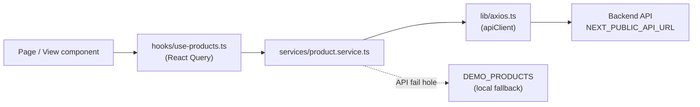

# Kinbo Frontend — Architecture

Ei document-e Kinbo e-commerce-er **frontend** (`frontend/` folder) kivabe banano, kon file ki kaj kore, data kivabe ashe, ar notun page / section / filter kivabe add korte hoy — sob bistarito bola ache.

---

## 1. Tech Stack

| Jinish | Ki use korchi | Keno |
|---|---|---|
| Framework | **Next.js 16.4** (App Router, Turbopack) | Routing, server rendering, metadata |
| UI library | **React 19.3** | Component-based UI |
| Language | **TypeScript 5** | Type safety |
| Styling | **Tailwind CSS v4** (`@tailwindcss/turbopack`) | Utility class diye styling |
| Server state | **TanStack Query v5** (+ Devtools) | API data fetch, cache, loading state |
| HTTP client | **Axios** | Backend API call |
| Icons | **lucide-react** | Sob icon |
| Lint | ESLint 9 + `eslint-config-next` | Code quality |

`next.config.ts`-e duto important setting on ache:

- `cacheComponents: true` — Next.js 16-er Cache Components. Er mane dynamic route-e `params` access korte hole hoy `generateStaticParams` dite hobe, noyto `<Suspense>` diye wrap korte hobe. Amra category route-gulote `generateStaticParams` use korchi.
- `partialPrefetching: true` — link prefetch optimize kore.

> **Note:** Ei Next.js version-e anek API ager version theke alada. Kono Next.js feature use korar age `node_modules/next/dist/docs/` folder-er docs dekhe nite hobe (`AGENTS.md`-eo eta bola ache).

### Run kora

```bash
cd frontend
npm install
npm run dev     # http://localhost:3000
npm run build   # production build
npm run lint
```

Backend URL `.env.local`-e `NEXT_PUBLIC_API_URL` diye set hoy. Na dile default `http://localhost:5000/api`.

---

## 2. Folder Structure

```
frontend/src/
├── app/                      # Next.js routes (shudhu routing + data wiring)
│   ├── layout.tsx            # Root layout: <html>, font, providers, CartDrawer, chat widget
│   ├── globals.css           # Tailwind import, brand color, custom utility
│   ├── page.tsx              # Home page  "/"
│   ├── categories/page.tsx   # Sob category-r list  "/categories"
│   ├── category/
│   │   └── [slug]/
│   │       ├── page.tsx              # Category landing  "/category/fashion-clothing"
│   │       └── [subSlug]/page.tsx    # Subcategory listing "/category/fashion-clothing/mens-fashion"
│   ├── products/             # "/products" ar "/products/[id]"
│   ├── cart/, checkout/, account/, orders/, inbox/, contact/
│   ├── error.tsx, not-found.tsx
│
├── components/
│   ├── layout/               # Navbar, Footer, PageLayout (sob page-er frame)
│   ├── common/               # Breadcrumbs, SupportChatWidget
│   ├── sections/             # Page-er reusable block: BannerCarousel, ShopByCategory, ProductRow ...
│   ├── filters/              # Config-driven FilterSidebar + PriceRangeSlider + filter logic
│   ├── modules/              # Feature-wise component: product/, cart/, home/
│   └── ui/                   # Choto generic UI: button, input, skeleton ...
│
├── views/
│   └── category/             # Protita category-r NIJER landing page design (10 ta file)
│
├── lib/
│   ├── categories.ts         # Category + subcategory-r single source of truth
│   ├── axios.ts              # Axios instance (baseURL, token, 401 handling)
│   └── utils.ts              # formatPrice, calculateDiscount, cn
│
├── services/product.service.ts  # API call + demo data fallback
├── hooks/                    # use-products (React Query), use-cart
├── context/cart-context.tsx  # Cart state (localStorage-e save hoy)
├── providers/                # QueryProvider + CartProvider eksathe AppProvider
└── types/ecommerce.ts        # Product, CartItem, Category type
```

**Niyom:** `app/` folder-er file-gulo patla rakhi — shudhu route, metadata, `params` pore thik component-ke props pass kore. Ashol UI thake `components/` ar `views/`-e.

---

## 3. Rendering Model (Server vs Client)

Next.js App Router-e default-e sob component **Server Component**. Jekhane state, effect, event handler, browser API lagbe, sekhane file-er upore `"use client"` dei.

| Kothay | Kon type | Keno |
|---|---|---|
| `app/layout.tsx` | Server | Shudhu HTML frame + provider boshay |
| `app/category/[slug]/page.tsx`, `[subSlug]/page.tsx`, `categories/page.tsx` | Server | `params` pore, `generateStaticParams` + `generateMetadata` dey |
| `Navbar`, `ProductListing`, `FilterSidebar`, `views/category/*`, `sections/*` (beshirbhag) | Client | Hover, scroll, filter state, React Query hook |
| `PageLayout`, `Breadcrumbs`, `ShopByCategory` | Kono directive nei | Server ar client duijaygay import kora jay |

**Server → Client props niyom:** Server component theke client component-e shudhu **serializable** data (string, number, array, plain object) pathano jay — function ba React component (jemon lucide icon) na. Ei jonno:

- Subcategory page (server) `ProductListing`-ke filter-er **config object** pathay, function na (dekhun §8)।
- Category landing page (server) shudhu slug diye registry theke component bachhe ney; icon-gulo client view-er bhitore `lib/categories.ts` theke ashe.

---

## 4. Routing

| URL | File | Ki dekhay |
|---|---|---|
| `/` | `app/page.tsx` | Home: hero, featured, catalog |
| `/categories` | `app/categories/page.tsx` | Sob category card |
| `/category/[slug]` | `app/category/[slug]/page.tsx` | Category-r nijer landing design (`views/category/*`) |
| `/category/[slug]/all` | `app/category/[slug]/[subSlug]/page.tsx` | Puro category-r sob product + filter |
| `/category/[slug]/[subSlug]` | same file | Ekta subcategory-r product + filter |
| `/products`, `/products/[id]` | `app/products/...` | Product list / detail |
| `/cart`, `/checkout`, `/checkout/success`, `/account`, `/orders`, `/inbox`, `/contact` | nijer folder | Baki page |

**Category route-er bistarito:**

- `[slug]/page.tsx` — `generateStaticParams()` 10 ta category slug return kore, tai build-e sob prerender hoy। Tarpor `CATEGORY_PAGES[slug]` (registry) theke oi category-r page component render kore। Na pele `notFound()`।
- `[subSlug]/page.tsx` — protita category-r jonno `all` + sob subcategory slug `generateStaticParams`-e dey। `subSlug === "all"` hole puro category, noyto ekta subcategory। Invalid hole `notFound()`।
- Slug nijei toiri hoy nam theke: `slugify("Men's Fashion") → "mens-fashion"`, `"Headphones, Earbuds & Speakers" → "headphones-earbuds-speakers"`।
- URL banate shob jaygay helper use kori, hardcode na:
  - `categoryHref(slug)` → `/category/slug`
  - `categoryHref(slug, subSlug)` → `/category/slug/subSlug`
  - `categoryListingHref(slug)` → `/category/slug/all`

---

## 5. Layout System

### 5.1 Root layout (`app/layout.tsx`)

Sob page-er bahire thake:

- `Inter` font (`next/font/google`) — CSS variable `--font-inter`।
- `AppProvider` = `QueryProvider` + `CartProvider`।
- `CartDrawer` ar `SupportChatWidget` — sob page-e global।
- `<head>`-e ekta choto inline script: kichu browser extension (jemon Bitdefender) React load howar age DOM-e `bis_skin_checked` type attribute dhukay, ja hydration error dey। Script-ta oi attribute-gulo muche fele। `<html>` ar `<body>`-te `suppressHydrationWarning` o ache।

### 5.2 `PageLayout` (`components/layout/PageLayout.tsx`)

Protita page ei common frame use kore — Navbar + content + Footer:

```tsx
<PageLayout onSearchChange={setSearchQuery} className="bg-white">
  <main className="flex-1 container mx-auto px-4 sm:px-6 py-6">...</main>
</PageLayout>
```

| Prop | Kaj |
|---|---|
| `children` | Page-er content |
| `onSearchChange?` | Navbar-er search box ei page-er sathe jore; na dile search kichu kore na |
| `className?` | Page-er background ityadi |

Navbar ba Footer bodlale ekbar `PageLayout`/`Navbar`/`Footer` bodlalei sob page-e change hoy।

### 5.3 Navbar (`components/layout/Navbar.tsx`)

- **Upor row:** logo (`/images/logo-trimmed.png`), search, Account / Orders / Inbox, cart button (badge-e item count)।
- **Category bar:** "Home" + `CATEGORIES` theke 10 ta category। Current route-er category-te orange underline।
  - Bar-e jaygay na hole `‹ ›` arrow ashe (scroll position dekhe)।
  - Page **80px-er beshi niche scroll korle bar collapse** hoy, **10px-er upore** fire ashle abar dekhay। Duto alada threshold (hysteresis) rakhechi karon bar collapse hole header choto hoy ar `scrollY` bodle jay — ek threshold hole bar kanpto (flicker)।
- **Hover dropdown (desktop):** category-te hover korle thik oi item-er niche 300px-er ekta list khule: prothome "All", tarpor subcategory (nijer icon + `›`)। Position header-er sapekkhe `getBoundingClientRect` diye hisab kori, screen-er baire jete dei na। Mouse sore gele 150ms delay-e bondho hoy, jate dropdown-e mouse niye jaoa jay। Category bar pashe scroll korle dropdown bondho hoy।
- **Mobile:** hamburger menu-te category grid + account link।

---

## 6. Category Data — Single Source of Truth (`lib/categories.ts`)

Sob category, subcategory, icon, rong ekhane define kora:

```ts
defineCategory(
  "Fashion & Clothing",                       // nam (slug nijei toiri hoy)
  "Trendy outfits, footwear, bags ...",       // description
  Shirt,                                      // category icon (lucide)
  "bg-rose-50 text-rose-600",                 // accent class (icon tile)
  [
    ["Men's Fashion", Shirt],                 // [subcategory nam, icon]
    ["Women's Fashion", ShoppingBag],
    ...
  ]
)
```

Ei data use kore: Navbar, dropdown, mobile menu, `/categories` page, category landing, subcategory page, filter-er link section, `generateStaticParams`, ar `product.service`-er default category list।

**Category ba subcategory add / rename korte** shudhu ei file bodlalei hoy — navbar, URL, page sob nijei update hoy। (Notun category hole tar landing page-o banate hobe, §7.3 dekhun।)

Helper:

| Function | Kaj |
|---|---|
| `getCategoryBySlug(slug)` | Slug theke category |
| `getSubcategory(category, subSlug)` | Subcategory khoja |
| `categoryHref`, `categoryListingHref` | URL banano |
| `CATEGORY_NAMES` | Shudhu nam-er list |
| `ALL_PRODUCTS_SLUG` | `"all"` |

---

## 7. Page Design System — Common Section + Alada Page

Amader niyom: **component common, page alada।** Protita category-r landing page nijer file-e, kintu sob page eki building block (section) props diye sajay।

### 7.1 Common sections (`components/sections/`)

| Component | Ki | Main props |
|---|---|---|
| `BannerCarousel` | Auto-slide banner, arrow + dot; hover-e thame | `slides[]` (`title`, `subtitle`, `image`, `theme`, `href`, `ctaLabel`, `fullImage`), `autoPlayMs` |
| `ShopByCategory` | Subcategory tile grid (mobile-e horizontal scroll) | `items[]` (`name`, `href`, `image?`, `icon?`), `tileClass`, `iconClass`, `title` |
| `ProductRow` | Horizontal product carousel + "see all" + arrow | `title`, `products`, `isLoading`, `seeAllHref`, `className` (tinted band) |
| `SubcategoryProductRows` | Je subcategory-te product ache tar jonno ekta kore `ProductRow` | `category`, `products`, `isLoading`, `bandClass` |

Banner-e duto mode:
- **Text banner** (default): `theme` gradient + bam-e boro lekha + dan-e image (fade mask)।
- **Image banner**: `fullImage: true` dile pura banner-ta shudhu image (designer-er banana banner-er jonno)।

Product na thakle `ProductRow` nijei lukiye jay (loading-e skeleton dekhay)।

### 7.2 Alada page (`views/category/`)

```
views/category/
├── index.ts                     # Registry: slug → page component
├── shared.ts                    # useCategoryProducts, subcategoryTiles, bestSellers, topDeals, unsplash
├── FashionClothingPage.tsx
├── ElectronicsGadgetsPage.tsx
├── ... (mot 10 ta)
```

Ekta page dekhte emon:

```tsx
"use client";
const SLUG = "electronics-gadgets";

export default function ElectronicsGadgetsPage() {
  const { category, products, isLoading } = useCategoryProducts(SLUG);

  return (
    <PageLayout className="bg-white">
      <main className="flex-1 container mx-auto px-4 sm:px-6 py-6 space-y-10">
        <BannerCarousel slides={[ /* ei page-er nijer banner */ ]} />
        <ShopByCategory items={subcategoryTiles(category)} tileClass="bg-blue-50" />
        <ProductRow title="Top Deals" products={topDeals(products)} seeAllHref={categoryListingHref(SLUG)} />
        <ProductRow title="Best Sellers" products={bestSellers(products)} className="... bg-blue-50/60" />
        <SubcategoryProductRows category={category} products={products} bandClass="" />
      </main>
    </PageLayout>
  );
}
```

`shared.ts` helper:

| Helper | Kaj |
|---|---|
| `useCategoryProducts(slug)` | Category + tar product (React Query) + loading |
| `subcategoryTiles(category, images?)` | `ShopByCategory`-er tile list; `images` map dile icon-er bodole chobi |
| `bestSellers(products)` | Review count / rating onujayi sort |
| `topDeals(products)` | Discount ache emon product, beshi discount age |
| `unsplash(id, width?)` | Unsplash image URL |

### 7.3 Recipe: ekta page-er design bodlano

1. `views/category/<Name>Page.tsx` khulun।
2. Section-er order bodlan, notun section boshan, ba bad din — shudhu oi page bodlabe।

### 7.4 Recipe: notun dhoroner section banano

1. `components/sections/<NewSection>.tsx` banan — sob content props theke nibe (hardcode na)।
2. Je page-e dorkar, sekhane import kore props diye boshan।

### 7.5 Recipe: notun category add kora

1. `lib/categories.ts`-e `defineCategory(...)` add korun।
2. `views/category/<Name>Page.tsx` banan (ekta existing page copy kore shuru kora shohoj)।
3. `views/category/index.ts`-e slug → component register korun।

Register na korle `/category/<slug>` 404 dibe — ichchha kore emon rakha, jate design chara page live na hoy।

---

## 8. Product Listing + Filter System

### 8.1 `ProductListing` (`components/modules/product/ProductListing.tsx`)

Subcategory page ar "all" page-er common page component। Nijei `PageLayout` use kore।

| Prop | Kaj |
|---|---|
| `title`, `description?` | Page heading |
| `breadcrumbs` | `{ label, href? }[]` — "Home" nijei age bose |
| `query?` | API filter: `{ category, subcategory }` |
| `filterSections?` | Sidebar-e kon section, kon order-e (na dile default) |

Bhitore ja kore:
1. `useProducts({ ...query, search })` diye product ane।
2. Sidebar-er `FilterState` diye client-side filter kore (`applyFilters`)।
3. Sort kore (Featured / Price low-high / high-low / Rating)।
4. Desktop-e bam-e sidebar (sticky na, page-er sathe scroll kore), mobile-e "Filters" button chaple bam theke drawer।

### 8.2 Config-driven `FilterSidebar` (`components/filters/`)

Sidebar-ta **config array** diye chole, tai server page-o plain object pathiye sidebar control korte pare:

```ts
filterSections={[
  { type: "links", title: "Fashion & Clothing", links: [{ label, href, active }] },
  { type: "price" },                                   // preset radio + drag slider + min/max
  { type: "discount", options: [10, 20, 30, 40, 50] },
  { type: "rating", options: [4, 3, 2] },
  { type: "facet", id: "subcategory", title: "Category", field: "subcategory" },
  { type: "facet", id: "tags", title: "Product Tags", field: "tags",
    searchable: true, searchPlaceholder: "Select Tags" },
  { type: "availability" },
]}
```

| `type` | UI | Option |
|---|---|---|
| `links` | Navigation link list (active highlight) | `title`, `links` |
| `price` | Preset radio + duto-thumb drag slider + Min/Max input + apply `›` | `presets?`, `step?`, `title?` |
| `discount` | "X% and above" radio | `options?`, `title?` |
| `rating` | Tara-shoho radio "& up" | `options?`, `title?` |
| `facet` | Checkbox list + count, lomba hole scroll | `id`, `title`, `field` (`category` / `subcategory` / `tags`), `searchable?`, `searchPlaceholder?`, `options?` |
| `availability` | "In stock only", "On discount" checkbox | `title?` |

Detail:
- Header-e **Clear All** (lal), protita section-e **Clear** (shudhu value thakle dekhay)।
- `facet`-er option na dile product theke nijei toiri hoy count shoho (`buildFacetOptions`)।
- Price slider-er range product-er sorbochcho price theke hisab hoy (min 0, max 100-er gunitoke round)। Preset, slider, input — tinta eki `price` state share kore, tai ekta bodlale baki-gulo sync thake।
- Slider-ta duto `<input type="range">` ekta-r upor arekta rekhe banano; style `globals.css`-er `.dual-range` class-e।

Filter logic (`filter-config.ts`):

| Export | Kaj |
|---|---|
| `FilterSectionConfig` | Section config type (serializable) |
| `FilterState` | `{ price, minDiscount, minRating, facets, availability }` |
| `EMPTY_FILTER_STATE` | Shuru-r / Clear All state |
| `applyFilters(products, sections, state)` | Filter apply |
| `buildFacetOptions(products, field)` | Checkbox option + count |

**Notun filter type add korte:** `filter-config.ts`-e type + `applyFilters`-e logic, tarpor `FilterSidebar.tsx`-er `switch`-e UI।

---

## 9. Data Layer



### 9.1 Axios (`lib/axios.ts`)
- `baseURL` = `NEXT_PUBLIC_API_URL` ba `http://localhost:5000/api`, timeout 10s।
- Request interceptor: `localStorage`-e `token` thakle `Authorization: Bearer <token>` header dey।
- Response interceptor: 401 hole token muche dey।

### 9.2 Service (`services/product.service.ts`)

| Method | Endpoint | Fallback |
|---|---|---|
| `getProducts({ category, subcategory, search })` | `GET /products` | `DEMO_PRODUCTS` local-e filter |
| `getProductById(idOrSlug)` | `GET /products/:id` | Demo theke khoja |
| `getCategories()` | `GET /categories` | `["All", ...CATEGORY_NAMES]` |

Backend ekhono ready na, tai API fail hole demo data dey — UI sob shomoy kaj kore। Backend ready hole response shape `Product` type-er moto hole kono frontend change lagbe na।

### 9.3 React Query (`hooks/use-products.ts`, `providers/query-provider.tsx`)
- Query key: `["products", "list", filters]`, `["products", "detail", id]`, `["products", "categories"]`।
- Default: `staleTime` 5 min, `gcTime` 30 min, window focus-e refetch na, retry 1 bar।
- Devtools development-e nicher kone dekha jay।

### 9.4 Types (`types/ecommerce.ts`)
`Product`-e ache: `id, name, slug, description, price, originalPrice?, category, subcategory?, rating, reviewCount, images[], stock, tags?, discountType?, deliveryTime?` ityadi। `category` / `subcategory`-er value `lib/categories.ts`-er **nam**-er sathe hubohu milte hobe (slug na)।

---

## 10. Client State — Cart (`context/cart-context.tsx`)

- `CartProvider` React Context — `cart`, `addToCart`, `removeFromCart`, `updateQuantity`, `clearCart`, `totalItems`, `subtotal`, `isCartOpen`, `setIsCartOpen`।
- `localStorage`-er `shopping_cart` key-e save hoy, page reload-e thake।
- `addToCart` korle drawer nijei khule।
- Use: `const { addToCart } = useCart()` (`hooks/use-cart.ts`)।
- Navbar-er badge hydration mismatch erate `useSyncExternalStore` diye shudhu client-e count dekhay।

---

## 11. Styling

- Tailwind v4: `globals.css`-e `@import "tailwindcss"` ar `@theme inline`-e brand token।
- **Brand color:**
  - Primary navy `#082F6B` (text, active state, button)
  - Secondary orange `#FF6B00` (underline, highlight, badge)
  - Background `#F3F7FC`, border `#E5E7EB`, text `#1F2937`
- Custom utility: `scrollbar-none` (horizontal list-er scrollbar lukay), `.dual-range` (price slider)।
- Gradient-e Tailwind v4 syntax: `bg-linear-to-r from-... to-...`।
- Container: sob page-e `container mx-auto px-4 sm:px-6` — tai navbar, content, footer eki line-e align thake।

---

## 12. Conventions

- **Props-driven component:** section / filter / listing-e content hardcode na kore props diye dei।
- **URL helper use korun:** `categoryHref(...)`, string concat na।
- **Data ek jaygay:** category = `lib/categories.ts`, API = `services/`, fetch hook = `hooks/`।
- **`app/` patla:** route file-e shudhu params, metadata, notFound, ar component-ke props।
- **Server → Client:** shudhu serializable props।
- **Comment:** shudhu sei jinish likhi ja code dekhe bojha jay na (keno threshold, keno hysteresis ityadi)।
- Edit-er por `npx tsc --noEmit` chalai।

---

## 13. Known Gaps / Pore korte hobe

- **Unused (legacy) file** — kothao import hoy na, muche fela jay: `components/ui/CartDrawer.tsx`, `components/ui/ProductCard.tsx`, `components/ui/SupportChatWidget.tsx`, `components/ui/modal.tsx`, `components/ui/badge.tsx`, `components/home/HeroBanner.tsx`, `components/home/ProductCatalog.tsx`, `hooks/use-debounce.ts`।
- **Search:** navbar search shudhu home, `/products` ar category listing page-e kaj kore (je page `onSearchChange` dey); onno page-e kichu kore na। Dedicated `/search` page nei।
- **`/products` page** URL query (`?category=`) pore na।
- **Filter state URL-e nei** — reload / share korle filter hariye jay। Pore `searchParams`-e rakha jete pare।
- **Image:** product ar banner `` tag + Unsplash URL; `next/image` + nijer CDN-e niye gele performance bhalo hobe।
- **Demo data:** ekhon 13 ta demo product, tai beshirbhag subcategory khali। Backend ashle bhore jabe।
- **Category landing banner** ekhon placeholder (gradient + stock photo); ashol design ashle `fullImage` banner diye replace korun।
